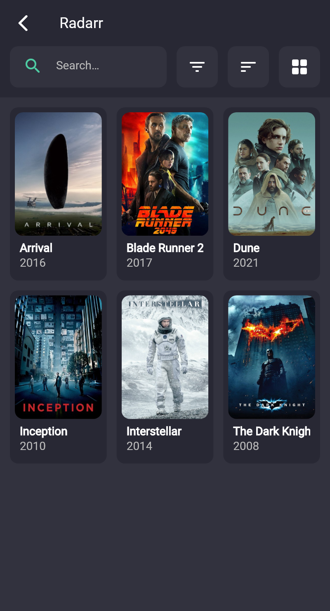
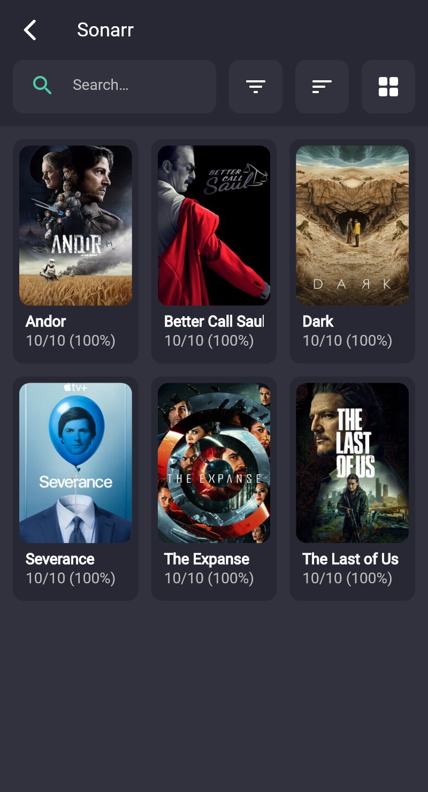
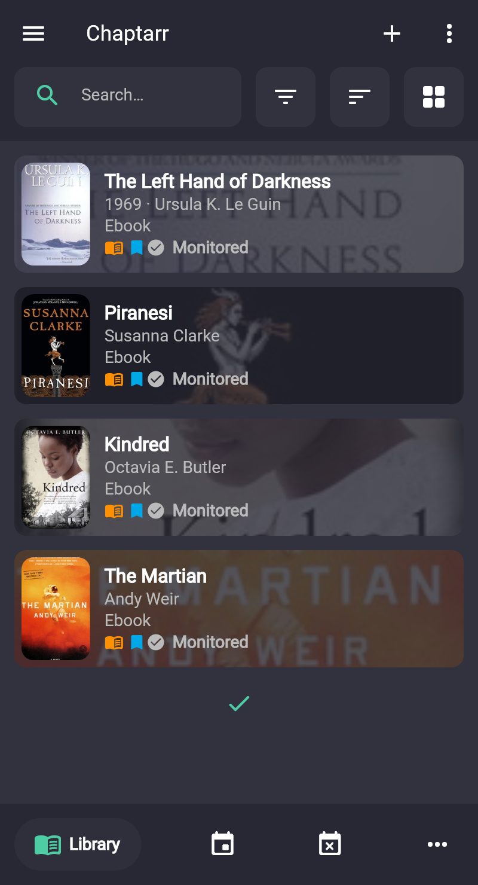
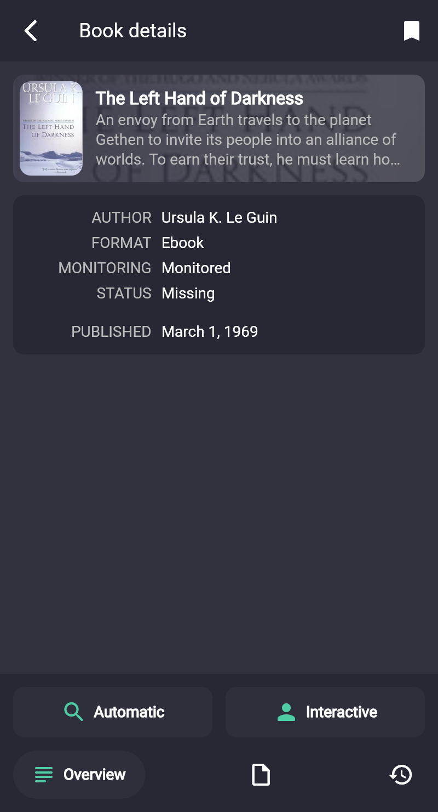

# LunaSea

LunaSea is a remote for the media services you run at home. Use it to add and monitor titles, pick releases, and check your download queues. Set up the services you want to control first. For library management, that means [Sonarr](https://github.com/Sonarr/Sonarr) for TV, [Radarr](https://github.com/Radarr/Radarr) for movies, [Lidarr](https://github.com/Lidarr/Lidarr) for music, or [Chaptarr](https://github.com/Chaptarr/chaptarr) for books. LunaSea connects directly to your servers.

This repo is a fork of [Dim145’s LunaSea](https://github.com/Dim145/lunasea), which continues [Jagandeep Brar’s original project](https://github.com/jagandeepbrar/lunasea).

  
  
  
  
  

  
  
  
  

Captured in LunaSea with demo libraries. Artwork comes from Open Library, TMDB, and TVmaze.

## Features

- Browse your libraries, add and monitor titles, check upcoming and missing releases, and view activity. **Browse ebooks and audiobooks in list or grid view, see book files and history, and check whether an import finished after a dropped connection.**
- **Filter interactive torrent results** in Sonarr and Radarr by tracker or indexer, quality, resolution, language, audio format, dual audio, and custom formats. **Chaptarr also filters by indexer, quality, audio format, and custom formats. Lidarr can filter by audio format, including FLAC and MP3.**
- Manage Usenet queues in SABnzbd and NZBGet. Search Newznab indexers and send NZBs to a download client.
- Check Plex activity in Tautulli and monitor streams in Tracearr.
- Switch between server profiles, back up and restore settings, and add shortcuts to other web apps. **External module links now open correctly on Android, with a simpler add and edit form.**
- Receive push notifications through the optional [ntfy webhook bridge](lunasea-notification-service/).
- **Version changes on `main` trigger an Android APK release.**

## Supported services

| Use | Services |
| --- | --- |
| Media libraries | [Sonarr](https://github.com/Sonarr/Sonarr) (TV), [Radarr](https://github.com/Radarr/Radarr) (movies), [Lidarr](https://github.com/Lidarr/Lidarr) (music), **[Chaptarr](https://github.com/Chaptarr/chaptarr) (ebooks and audiobooks)** |
| Usenet downloads | [SABnzbd](https://sabnzbd.org/), [NZBGet](https://nzbget.com/) |
| Indexer search | [Newznab](https://www.newznab.com/) |
| Stream monitoring | [Tautulli](https://tautulli.com/), [Tracearr](https://github.com/connorgallopo/Tracearr) |
| Webhook notifications | [ntfy](https://ntfy.sh/) via the optional [LunaSea notification service](lunasea-notification-service/) |
## Get started

1. Install the APK from [GitHub Releases](https://github.com/steven-ahfu/lunasea/releases/latest).
2. Open **Settings → Configuration** and enable a service.
3. Enter the server URL and credentials, then tap **Test Connection**. Open the service from the drawer. [Chaptarr setup guide](docs/modules/chaptarr.md)

The Flutter app also targets iOS, macOS, Linux, Windows, and web. But none are tested other than the APK. Do not expect support for them.

## Acknowledgments

Thanks to [Jagandeep Brar](https://github.com/jagandeepbrar/lunasea) for building the original LunaSea and to [Dim145](https://github.com/Dim145/lunasea) for continuing it. I forked Dim145’s repo and maintain this version.
## License

[GPL v3 license](lunasea/LICENSE.md)
